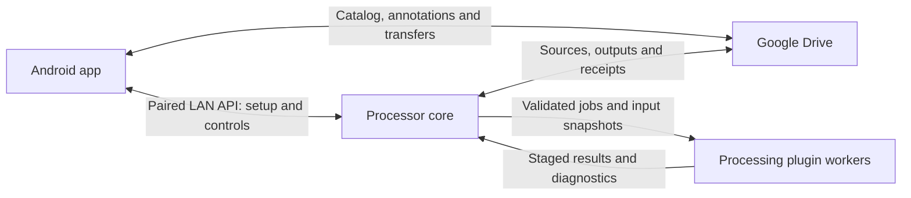

# MPA 0.6 — Android app and Processor redesign

Date: 2026-10-19, Asia/Jerusalem. Status: approved implementation specification; Stage 0 started. See `IMPLEMENTATION_STATUS.md` for actual progress.

Planned first joint release: **MPA 0.6.0**, Android versionCode **45** if it remains the next available code, Processor version **0.6.0**, library/protocol major **1**. Verify these against the repository before implementation; do not overwrite an existing release or reuse a versionCode.

**Owner revision, 2026-10-20:** MPA Desktop becomes a full photo client with a locally hosted web UI usable from another computer on the same LAN. The engine keeps running independently of browser sessions. See `DESKTOP_WEB_REVISION.md`, which supersedes the small Avalonia interface and related setup-only journeys below. Internet access remains deferred. All unattended completion and integrity gates remain applicable.

**Latest owner correction:** the mobile app communicates only with Google Drive, never directly with Desktop/Processor. All older phone LAN/API/pairing/discovery instructions below are superseded. Required mobile settings/processing requests and applied receipts must use the Drive-only coordination described in `DESKTOP_WEB_REVISION.md`. LAN access is exclusively for desktop browser clients.

This document supersedes the architectural recommendations in `MPA_PROCESSOR_DISCUSSION_2026_10_17.md` and `PROCESSOR_DISCUSSION_NOTES.md`. Those are historical research, not instructions to retain phone inference or avoid LAN communication.

## 1. Execution boundary and effort handoff

The original planning-only stop was satisfied: the owner subsequently reported switching to High and directed emulator-first implementation. Do not request that confirmation again. Preserve the approved unattended execution scope; actual Stage 0 gates still require evidence.

Owner answers received on 2026-10-19: **personal testing first**, with Android and all three desktop platforms retained; **no purchases**, and documented test installers are explicitly accepted where publisher-signing credentials are unavailable. This is not general-public onboarding approval or permission to claim unsigned software is publisher-trusted.

Owner revision on 2026-10-19: **start development and routine tests with emulators; use the S23 only for final tests**. The phone no longer blocks implementation startup, and its reported connection is not treated as independently verified physical acceptance. Google Cloud browser access and a usable Drive account/test workspace still need actual verification. Use the owner's Chrome session. If those required connections are unavailable, ask for reconnection; browser sign-in does not prove Drive API feasibility. Recheck the S23 connection at final acceptance and request reconnection then if needed. See `MPA_PROCESSOR_PREFLIGHT_2026_10_19.md` for observed status.

The implementation is designed for High effort: eleven bounded stages, explicit contracts, prerequisite gates, focused commits, fixture-driven checks, and a durable stage ledger. Follow `MPA_PROCESSOR_IMPLEMENTATION_HANDOFF.md`. Resolve routine implementation details autonomously within these decisions. Ask only for genuinely missing access, an external consent/purchase, a consequential scope change, a blocking defect, an unresolved warning, or a failed protection/verification requirement.

Owner clarification, 2026-10-19: after the effort-change opportunity and explicit instruction to begin, execute **unattended through the entire first joint release**. Stage boundaries, focused commits and progress updates are internal checkpoints, not requests for permission or reasons to hand back an unfinished product. Continue through all included features, regression fixes, warning resolution, native installer work, final validation, publication and independent public-asset verification. No routine stage approval or visual-review pause is required. Do not silently drop included features, weaken gates, expand the deferred scope or declare completion after an intermediate increment. If context or execution limits interrupt work, retain the exact durable checkpoint and resume from it when execution is available; do not claim work continued while it could not run. Only a genuine blocker requiring human input or an explicit owner stop justifies a pause; state the concrete blocker and continue independent authorized work where useful.

Do not create separate user chats or delegate work unless separately authorized. Do not publish an intermediate Android-only replacement as the completed redesign.

## 2. Product decisions

1. Android remains Kotlin, Jetpack Compose and Material 3. Preserve the current photo-first gallery and interaction work.
2. The Processor uses C# on .NET 10 LTS, with Avalonia for its small desktop interface. It runs on Windows, Linux and macOS.
3. Initial heavy analysis runs **only on the Processor**. Phone fallback is deferred. A missing computer means pending analysis, not an unusable gallery.
4. Both clients use Google Drive directly. Google Drive for desktop is optional and never a prerequisite.
5. Initial setup, feature controls, commands and live progress use an authenticated LAN API, discovered automatically using mDNS/DNS-SD. Raw UDP discovery is a fallback only if measured interoperability requires it; never use UDP for job payload delivery.
6. Drive stores durable library data, human annotations, processing outputs and receipts. Remote delivery of processor control commands through Drive is deferred. Durable data synchronization is required in the first release.
7. One designated Processor and one controlling phone per library in the first release. Multiple source accounts/folders remain supported. Design records so future additional devices do not require replacing identities.
8. Originals are protected. Background analysis never changes original content, embedded metadata, names, locations or trash state. Such changes require an explicit user-approved action with exact scope.
9. Use one managed metadata workspace, separate from selected photo folders. Folder names and paths do not define media identity. No required reorganization of existing source folders.
10. Preserve human corrections and explicit identity decisions when analysis is rebuilt. Imported and manually named people share the same canonical Person model.
11. Processing uses first-party plugins behind a versioned worker protocol. Third-party plugin installation, a marketplace, arbitrary scripts and hot replacement of active plugins are deferred.
12. The joint personal-test release contains the APK and native Processor installers for all three desktop platforms, with independently verified evidence. Public asset hosting does not imply general-public OAuth/onboarding readiness.
13. Breaking local database/library changes and a clean Android installation are acceptable. This authorizes simplifying compatibility work; it does not authorize deleting source media, previous Drive libraries, local-only originals or human annotations automatically.

### Included in the first joint release

| Area | Included behavior |
| --- | --- |
| Phone | Unified device/Drive gallery, Collections including device folders, viewer, selection, ordinary indexed Search, manual organization, explicit backup, safe offline-download cleanup, Drive Trash/restore and Processor controls. |
| Processor core | Accounts, source discovery, durable jobs, scheduling, resource budgets, authentication, LAN pairing, synchronization, tray/status UI, exit, install, upgrade and uninstall. |
| Processing | Metadata/Takeout association, multiresolution previews, human face analysis and reviewed-identity suggestions, object/category labels, OCR, video facts/poster generation. |
| Imports | Local ZIP, extracted folder and Drive ZIP inputs, multiple parts, per-item recovery, captured destinations and verified original uploads. No Takeout URL input or permanent ZIP-backed originals. |
| Integrity | Protected inputs, verified outputs, causal human operations, immutable result records, tombstones, explicit conflict presentation and interrupted-operation recovery. |

Individual pet identity recognition, generative editing, cloud AI APIs, a hosted MPA service, arbitrary natural-language semantic search while away from the computer, GPU acceleration as a requirement, general shared-library collaboration and phone inference are outside this release. Do not expose controls implying these features exist.

## 3. Baseline and reuse boundaries

The published baseline is 0.5.33/code 44. Tested application source: `7714d96b6f8b654c8f16e6358dd9d993356380fe`. Published documentation/tag revision: `6c9ead7b1d4446dc819dee71974aa7b68614f232`. Evidence is in `release-0533-7714d96/completion.json` and its associated publication artifacts. Confirm the actual current repository state at Stage 0.

Read-only inspection for this plan found:

- `TimelineRepository`, keyset paging, viewport/anchor owners and viewer sessions already exist. Reuse their semantics rather than start a second gallery implementation.
- `DriveGateway`, authorization/access-session owners, durable backup/import workers and Trash handling already exist.
- `AdaptiveThumbnailStore`, original verification, protected cache leases and device MediaStore integration already exist.
- `CanonicalPeopleRepository`, imported-label handling and manual metadata controls already exist.
- Android `PeopleRepository`/`PeopleWorker` currently use ML Kit detection/labeling and a bundled LiteRT MobileFaceNet model. These are Android dependencies, not desktop-ready processing plugins.
- Build gates already fail on Android lint/Kotlin/Java warnings. Preserve those gates.

| Existing area | Planned treatment |
| --- | --- |
| Timeline/viewer/selection/navigation | Retain working behavior and protections; adapt data access to the new catalog. |
| Original transfer, verification, availability, cache budgets | Reuse verified components where responsibilities fit; add new protocol receipts, not a second transfer engine. |
| Device discovery and folders | Retain, with no automatic camera backup or inference. |
| Canonical people/manual annotations | Reuse domain semantics; move generation/matching to Processor and synchronize portable decisions. |
| Phone People workers, ML Kit/LiteRT assets and inference setup | Remove from normal scheduling and final app dependencies after remote replacements pass. No hidden fallback. |
| Phone Takeout archive expansion and bulk derivation | Replace with upload/staging and Processor job tracking. |
| Old database/schema/catalog compatibility | No mandatory migration. Detect incompatible old state and explain recovery/clean installation; never use destructive fallback silently. |

Android retains computation necessary for ordinary interaction: media decoding, playback, zoom, bounded interactive edit previews/explicit save-copy rendering, local text/index queries, transfer checksums and protocol validation. It does not schedule batch recognition, OCR, archive extraction, video analysis or library-wide preview generation. This distinction must be visible in the responsibility tests.

## 4. User journeys

### Install and connect

1. Install the Processor's native package. It opens a small setup/status window and registers optional start-at-login behavior, enabled by default and clearly changeable.
2. Connect each required Google account through the computer's system browser. Credentials remain on that computer.
3. Discover an existing compatible library, or offer to create one managed workspace. Multiple candidate libraries require a choice; never guess from folder name.
4. Open MPA on the phone, choose **Connect a computer**, grant the relevant OS network permission and discover nearby processors.
5. Select the computer on first connection and confirm a matching pairing code on the computer. No manual IP, port, router configuration or developer credentials.
6. Configure source folders, default upload destination and feature consent from the phone. The Processor acknowledges the applied configuration revision.
7. Normal operation requires no open desktop window. The Processor scans/processes in the background while the phone remains independently usable.

Additional source accounts require independent Google consent on the Processor. Pairing does not transfer the phone's Google tokens. Fully unattended/headless first-time OAuth setup is deferred; the headless core can run after supported interactive setup.

### Normal use and absence

| Situation | User-visible behavior |
| --- | --- |
| Device photo not uploaded | Appears immediately, no In Drive badge; explicit Back up action. It is not available to the Processor yet. |
| Uploaded original, analysis unfinished | Browse/view normally; feature-specific status says waiting or processing. |
| Computer asleep or phone on another network | Cached results and direct Drive browsing/transfers continue. Analysis waits; no phone inference starts. |
| Phone absent, computer online | Processor continues its last acknowledged policy and publishes results to Drive. |
| Feature changed away from LAN | Save a pending command locally; show **Waiting to connect to Home computer**. Do not claim the remote setting has applied. |
| Drive unavailable but LAN works | Status/control can work locally. Results can be pending publication; do not claim Drive synchronization or verified backup. |
| No Processor configured | Basic gallery, viewer, organization and transfers work. New Processor-dependent results are explicitly unavailable/pending. |

The first release does not automatically send device-only originals directly over LAN for analysis. Explicit Drive backup makes them available. This avoids another original-transfer authority and any implied backup from a computer-local temporary copy.

### Tray and shutdown

Tray/menu-bar controls: status, open window, pause/resume, start at login, diagnostic export, and **Exit**. Exit stops the actual core and worker process tree, stops accepting work, checkpoints interrupted jobs, closes owned resources and exits. Closing the window can leave the tray running; Exit cannot. Linux desktops without tray support retain a status window with Exit. The headless core has explicit status/stop commands.

## 5. Architecture and object ownership

Use one monorepo and one joint release tag. Keep the existing `app/` location to reduce build churn. Proposed new areas: `processor/`, `protocol/`, `packaging/`, `tests/interop/` and `docs/processor/`. Schemas/golden wire fixtures are shared specifications; do not force Android to consume .NET assemblies or port Android to C#.

| Owner | Responsibility |
| --- | --- |
| `LibraryCoordinator` | Library identity, active Processor epoch, source bindings and capability compatibility. |
| `DriveAccountSession` / `CredentialVault` | Per-account OAuth lifecycle and OS credential storage; no global mutable bearer token. |
| `SourceCatalog` / `SourceReader` | Incremental source discovery and verified, version-bound inputs. |
| `OriginalActionGateway` | Only approved operations that create/change/move/trash/restore original media. Analysis has no access to this interface. |
| `JobCoordinator` / `JobStore` | Durable state transitions, dependencies, deduplication, retry eligibility and recovery. |
| `PluginHost` / `WorkerLease` | Worker process ownership, protocol compatibility, cancellation and enforced completion/disposal. |
| `StorageBudget` / `InputLease` | Reserved space, protected readers, bounded staging and deletion eligibility. |
| `CatalogPublisher` / `CatalogConsumer` | Verified immutable artifacts, complete manifests and incremental local materialization. |
| `AnnotationRepository` / `ConflictResolver` | Human operations, causal revisions, corrections and visible conflicts. |
| `LanControlService` / `PairingService` | Device trust, encrypted API, idempotent commands and applied acknowledgements. |
| `ProcessorStatusViewModel` | Desktop/tray presentation without direct ownership of jobs or Google credentials. |
| Android adapters | Durable outbox, Processor state, catalog ingestion and existing gallery/viewer repositories. |

The core owns one local SQLite database with transactional jobs/outbox and a single-writer strategy. Android retains Room as its local query/cache database. **Neither database file is synchronized through Drive.** Persistence, media availability, UI state and job state remain separate responsibilities.

Every file, stream, native decoder, inference session and child process has a clear owner. Use `using`/`await using`, cancellation scopes and explicit leases. Do not dispose input memory while native work still uses it; await termination or terminate the worker before releasing its leases. Finalizers/GC are not the normal cleanup path.

## 6. Gate A: prove Google Drive access before the full build

Google supports installed desktop applications and background refresh, but this plan does **not** claim MPA's live project has been verified. The older setup record describes External/Testing on October 11. Testing tokens for Drive expire after seven days; production refresh can operate without repeated consent, but revocation/policy still applies. [Desktop OAuth](https://developers.google.com/identity/protocols/oauth2/native-app), [expiration](https://developers.google.com/identity/protocols/oauth2#expiration).

Stage 0 must produce `drive-feasibility.md` with redacted evidence:

1. Inspect current Google project, API enablement, Android/desktop client registrations, publishing status, grants and verification requirements. Preserve existing clients and signing material.
2. Define production registration for MPA. End users must not create Cloud projects or paste API credentials.
3. Test a narrow `drive.file` workspace case and an existing-folder case, including files added manually after authorization and nested descendants. Prove Android/desktop cross-client access to shared protocol files. Do not rely on private `appProperties` for interoperability.
4. The functional default for arbitrary existing folders is broader Drive access where authorized. It is an OAuth permission boundary, not a claim of folder-scoped Google access. Internally restrict operations to selected roots. Document the actual verification requirements; do not silently switch to a limited scope that cannot fulfill discovery. [Scopes](https://developers.google.com/workspace/drive/api/guides/api-specific-auth).
5. Determine whether the intended distribution qualifies for a verification exception or needs Google review and possibly a security assessment. A personal test arrangement does not establish readiness for general public users. Do not promise the self-hosted deployment automatically avoids review. [Verification](https://developers.google.com/identity/protocols/oauth2/production-readiness/restricted-scope-verification).
6. Obtain fresh desktop authorization through system browser, loopback callback, PKCE/state validation and secure local token storage. Test refresh after access-token expiry and after restart, suspension and temporary network loss.
7. Begin a real elapsed-time test beyond seven days using the intended production configuration while other work proceeds. Do not manipulate clocks or claim a short forced-refresh test proves long-term operation. Record fresh-token issuance/configuration dates and check again before final release. If time/access prevents this, report it as an unmet acceptance item requiring an explicit owner decision.
8. Exercise revoked grants, denied scope, 401, 403 policy/permission errors, 429/rate limit and 5xx. Refresh automatically when valid; never repeatedly log out for ordinary network failures or create consent loops.
9. Verify source and workspace account permissions independently, including additional accounts. No accidental retargeting of historical jobs or copying account credentials between clients.

Secure storage: OS-protected storage on Windows, Keychain on macOS, Secret Service/keyring on supported Linux desktops. If protection is unavailable, stop account setup with an actionable explanation; no silent plaintext token file. API keys, refresh tokens, signed URLs/session URIs and private keys never appear in Drive protocol objects, logs or public CI artifacts.

Gate A's immediate exit is configuration/access/refresh feasibility, a documented viable verification path and the start of the elapsed-time test. The beyond-seven-day observation remains a Stage 9 release requirement and does not require idling before other implementation can proceed.

The owner selected a personal-test audience. Evaluate the applicable personal-use path without doing unnecessary general-public verification work. A personal-test release is distinct from the OAuth publishing status **Testing**: do not accept recurring seven-day reauthorization as solved merely because the audience is personal.

Purchases and paid verification are not authorized. Approval to implement is not approval to change public OAuth status blindly or revoke existing grants. Prepare exact changes and ask when external account consent is necessary. Failure of the immediate feasibility gate blocks the full architecture; do not spend subsequent stages pretending it passed.

## 7. Identity, workspace and source rules

### Workspace

One ordinary user-chosen Drive folder is the **MPA library workspace**. Its implementation-managed areas hold descriptors, human operations, catalog manifests, generated artifacts and temporary imports. An optional separate **YourStuff** source/destination accepts new uploads. These are logical roles, not required user folder names. Do not require the owner to adopt the earlier multi-folder tree.

Source folders can be elsewhere in Drive and retain their hierarchy. Keep MPA metadata out of them by default. Sidecar export beside originals is an explicit future/export action, not an automatic analysis step. Plugin executables and credentials are local installations, never executable content taken from Drive.

Use Drive IDs for workspace/source references. Duplicate names, renames and moves cannot identify or replace a different photo. Workspace sharing/inherited access is checked and explained during setup: metadata/previews contain private material and are not private merely because their folder name is obscure.

### Stable records

| Record | Identity and required semantics |
| --- | --- |
| Library | Random stable `libraryId`, protocol major/minor and supported required capabilities. |
| Actor | Stable device ID and verified pairing/public-key association; new install gets a new actor identity. |
| Asset | Stable `assetId`; one logical photo/video with explicit links to representations. |
| Representation | Device volume/row revision or Google account identity + Drive file ID; link only through verified transfer or explicit verified association. |
| Content | Byte length and verified content fingerprint; Drive modification time/version alone is insufficient. |
| User operation | Unique operation ID, actor sequence, causal parents/base field revisions, typed payload and target identity. |
| Processing result | Asset/content identity, feature/recipe/model fingerprint, parameters, producer/authority epoch, artifact hashes and outcome. |
| Job | Stable ID, dependencies, captured source/destination, consent/settings revision, checkpoints and stage outcomes. |

Never merge distinct unlinked assets merely because their bytes or names match. Artifact storage may reuse identical derived bytes without merging photo identities. A local-only photo receives an asset ID before backup; verified backup adds a representation to that identity.

For independent first discovery of a Drive item, both clients derive the same provisional asset ID from the library namespace and canonical account/file representation key. Do not mint unrelated random cloud IDs on each device. A device-origin asset has its persisted ID before upload; the verified transfer receipt names that preferred asset ID and the new Drive representation. If cloud discovery raced ahead, a durable alias joins only those verified representations and retains all previously issued IDs for lookup/viewer resolution. This is representation association, not content-based deduplication. Stage 1 must specify deterministic alias resolution and reject cycles/conflicting preferred identities; Stage 4 tests upload/discovery races and visible-key preservation.

Actor sequences are durable monotonic counters, not wall-clock timestamps. A restored installation that cannot prove its sequence continuity enrolls a fresh actor rather than reusing operation IDs.

Capture chronology retains provenance: original capture time, imported Takeout override/metadata, valid source modification time and unknown date. Preserve the established deterministic ordering and timestamp semantics. An imported metadata correction is an annotation; do not rewrite the source EXIF to manufacture chronology.

Different Google accounts require their own authorized sessions. A workspace holding results from multiple accounts requires an explicit source/library association and an explanation of where derived data is stored. Do not silently expose work-account data to a differently shared personal workspace.

## 8. Synchronization and conflicts

### Durable publications

Use schema-defined JSON records and bounded compressed catalog chunks, with binary artifacts referenced by immutable IDs/hashes. Specify all encodings, timestamp units, orientation coordinates, enum/error values, unknown-field behavior and numeric limits in `protocol/`. Major incompatibility gives an actionable update message and preserves cached content; it is never interpreted as an empty library.

Every local human change commits its domain change and outbox record in the same transaction. Upload objects with persisted IDs; retry the same operation rather than inventing a second one after a lost response. Upload/verify artifacts first, publish a complete manifest last. A reader validates the descriptor, hashes, required dependencies and authority before applying it.

Use independent producer streams. Mutable small heads are discovery hints owned by a single producer; they are not the only recovery record. Immutable commit descriptors retain ancestry and enable recovery if a head is stale or lost. Do not build a shared writable `messages.json`, depend on atomic folder creation, or claim Drive supplies distributed transactions/exactly-once delivery.

The Processor incrementally consumes human annotation operations and publishes catalog/results. Android consumes Processor generations and uploads human operations/receipts. Save Drive change cursors only after associated work is durable. Periodic reconciliation repairs missed discovery and stale heads. Drive's change feed describes file changes, not every application operation; our operation records retain meaning. [Change tracking](https://developers.google.com/workspace/drive/api/guides/manage-changes).

Initial defaults: at most 1,000 catalog entries or 4 MiB compressed per chunk, whichever comes first; parser/document limit 16 MiB expanded per protocol chunk; no base64 image payloads. Index manifests page rather than grow without bound. Prototype and freeze exact bounds in Stage 1 fixtures; any increase retains bounded parsing/memory.

Idle desktop polling starts at 60 seconds and backs off toward 5 minutes; productive work and foreground app refresh can poll more promptly within a rate limiter. No per-photo progress heartbeat writes. Record API call counts. Google push requires a receiving HTTPS endpoint, so it is not a zero-server prerequisite. [Drive push](https://developers.google.com/workspace/drive/api/guides/push). Batching does not eliminate individual API quotas or support batched media transfer. [Performance](https://developers.google.com/workspace/drive/api/guides/performance).

### Processing ownership

The controlling phone approves the designated Processor and its authority epoch. Only that Processor publishes canonical generated catalog generations. Restarting the same Processor resumes its journal; takeover requires an explicit replacement action and new epoch.

An old disconnected Processor may compute, but readers reject its obsolete authority once the replacement is known. An offline client can show its last verified view; do not promise instantaneous global revocation. Two conflicting authorized heads at the same epoch are an invariant failure: retain the last agreed catalog and require reconciliation rather than choose by clock time. Use local single-instance locking as well; it is not a substitute for authority validation.

Work key: asset ID + verified source-content fingerprint + feature + complete recipe/model/parameter fingerprint. Before computation, check valid committed work; before publication, revalidate input and consent/configuration. A canceled/revoked result cannot be promoted just because its worker finished late.

### Conflict policy

| Condition | Required result |
| --- | --- |
| Repeated operation/publication | Idempotent application by ID. |
| Same work key and identical result hash | One logical result; retain useful receipts without duplicating library entries. |
| Same work key, different output | Preserve candidates; retain the previously accepted result. A new conflicted slot is pending until validated/recomputed/resolved. Log nondeterminism; no silent overwrite. |
| New model/recipe | Separate result namespace. Activate through an acknowledged policy revision; never compare incompatible vectors. |
| Human correction vs generated suggestion | Explicit correction/rejection wins. |
| Causally later human edit | Apply to the referenced field revision. |
| Concurrent independent fields | Merge if domain invariants remain valid. |
| Concurrent same-field edits | Preserve alternatives and common prior value; show a conflict. A resolution operation references all conflicting parents. No wall-clock last-writer-wins. |
| Concurrent person merges/splits | Validate redirects/cycles and reviewed memberships. Conflicting structures require explicit resolution. |
| Original changed during analysis | Do not attach stale results to the new content. Requeue only affected stages. |
| Trash/tombstone vs old result | Tombstone prevents resurrection. Restore is explicit and targets the current tombstone. |
| Source disconnected or access lost | Mark availability/coverage honestly; preserve metadata and other sources. |

Human annotations include names, aliases, person merges, confirmed/rejected face assignments, captions, favorites, albums, archive state, capture/location overrides and edit recipes. Keep these outside disposable analysis caches. Invalid domain combinations must not be disguised as an empty/completed state.

Compaction preserves unresolved conflicts, deletion tombstones and operations not acknowledged by supported registered devices. Use an explicit minimum-supported-history generation: long-offline consumers beyond it fetch a verified fresh snapshot and replay their local outbox. Do not garbage-collect originals, user decisions, pending uploads or failed-item evidence with derived artifacts.

### Applying updates without jumps

Android stages and validates chunks off the main thread into generation-scoped local storage using bounded Room transactions. A short activation transaction switches the accepted-generation pointer only after the manifest and required dependencies are complete. Readers use the active generation plus local device/transfer facts and human-operation overlays; no clear-and-refill of live tables. Reclaim superseded generated rows only after relevant reader/session leases are released. Stage 1 freezes indexes and bounded delta/recovery behavior so this is not an unbounded full-library duplicate on every progress update.

Do not expose half-applied generations as an empty gallery. Keep usable prior rows/previews during refresh/error. Preserve canonical identity, frozen tile geometry, pixel offset, selection and disposable viewer sequence. Newer arrivals show an unobtrusive New photos action rather than repacking the visible viewport.

## 9. Original protection and approved actions

Automatic analysis has a read-only source interface. Plugins receive verified staging snapshots; they never receive Google credentials, writable original paths or the `OriginalActionGateway`.

Every operation that changes an original's bytes, embedded metadata, name, folder or trash state has a durable approved intent containing actor, operation ID, exact target identities/revisions, requested action and destination/options. An explicit bulk confirmation can cover a displayed set. A generic recognition toggle or library consent cannot authorize these operations.

Before execution, recheck source identity/revision and authorization. If the user-approved revision changed, refuse the mutation and request review. A read-then-write check is not an atomic conditional write: if the backend cannot enforce the required precondition, do not implement a potentially destructive replacement. Initial edited output uses **Save a copy**, with a new verified file and relationship to its original.

Generated output is staged, size/hash/format checked and atomically promoted locally where supported. Remote promotion is a verified object plus manifest/receipt, not a claim of cross-file atomicity. Never replace a source original with a partial file. Failed copies remain recoverable staging, not a success badge.

Drive Trash/restore use Drive's actual trash state, not a separate phone trash store. No permanent original deletion or Empty Drive Trash in the initial redesign. Device deletion, removing a verified downloaded copy and trashing a Drive original are separate actions with clear scope. Network/auth ambiguity preserves local files. Retain the safe offline-clear option: verify a current remote original and no protected reader/pin/local-only state before deletion.

Explicit Back up or import approves creation of the selected originals at its captured destination. It does not approve editing or deleting the input. Hash exact uploaded bytes, verify remote size/checksum using supported backend fields, and use read-back verification where needed; never fabricate a remote SHA-256. Thumbnail/result publication never sets the In Drive original badge.

An Import all approval may bind an immutable archive/input-manifest revision, a recorded selection policy and a destination rather than enumerate unknown extracted entries on the phone. The Processor resolves and records that scope before creating originals. Newly added ZIP parts/changed input revisions require their own approved scope; ordinary source scanning never grants import or modification authority. Where a source can change during reading, verify the observed revision before and after and reject mixed/stale input rather than publish it. MPA cannot prevent external applications from modifying their own files; it must detect mismatches and preserve the last verified result.

## 10. Plugin and job contracts

### Worker model

Use .NET 10 LTS for the core, pinned stable Avalonia, and separate worker processes. First-party C# workers can share DTO libraries; other runtimes use the same framed/versioned IPC contract. Do not require dynamic in-process DLL loading to obtain extensibility. `AssemblyLoadContext` resolves dependencies but is not a security/reliability sandbox. [Microsoft guidance](https://learn.microsoft.com/en-us/dotnet/core/tutorials/creating-app-with-plugin-support).

Each plugin manifest declares ID/version, protocol range, capability/settings schema, supported OS/architecture and formats, model hashes/licenses, recipe fingerprint, expected resource budget and restart/checkpoint behavior. The phone renders only supported typed settings; no downloaded executable UI/scripts.

Worker lifecycle: handshake/capabilities, prepare job, progress/checkpoint, result/failure, cancellation acknowledgement and exit. Results reference files in an assigned staging directory with validated relative paths and hashes. No arbitrary path traversal or URLs in worker output. Core verifies content before publication; stderr is diagnostics, not protocol.

Use first-party authenticated release packages and pinned plugin/model hashes. No automatic execution of plugin binaries found in Drive. Workers receive only assigned staging inputs/output directories and minimal environment. A separate process is not a complete same-user security boundary; do not advertise untrusted plugins as safe. Third-party support would require a separately validated OS isolation model.

### Jobs and recovery

Job states: queued, waiting for input/processor/authorization/storage/dependency, running, canceling, paused, completed, completed with issues, retryable failure and terminal unsupported input. Store per-item/per-stage outcomes and verified receipts. Never derive durable success from UI counters.

Failure classes:

- Invalid media/unsupported format: fail that item/stage, keep unrelated work running.
- Optional metadata failure: preserve original import; record metadata pending/issue and retry that stage only.
- Network/rate limit: bounded exponential backoff with jitter and persisted checkpoints.
- Authorization: pause affected account-dependent work; keep other accounts and local jobs usable.
- Low storage: stop reserving work, preserve successful checkpoints, present safe cleanup options.
- Cancellation: propagate it; preserve verified results and mark only unfinished stages retryable.
- Internal invariant violation: stop the affected publisher/worker, retain evidence and last verified catalog, fail loudly. Do not swallow exceptions or label them operational success.

Resume retries only failed/unfinished stages. A thumbnail failure cannot trigger original re-upload; a completed original whose receipt is temporarily unknown must be reconciled before retry. Persist reserved file IDs, resumable upload sessions and server-acknowledged offsets. Handle expired upload sessions independently of completed receipts. [Upload protocol](https://developers.google.com/workspace/drive/api/guides/manage-uploads).

### Resource defaults

Initial desktop defaults: one heavy worker at a time, at most two inference CPU threads, memory budget no more than 2 GiB or 25% of physical RAM (whichever is smaller), private cache capped at 10 GiB with a free-space reserve of at least 2 GiB or 5% of volume capacity. Use the smaller safe usable cache on small disks; do not allocate a negative reserve. Users can change these through acknowledged settings. Large/unsupported workloads wait with an explanation rather than overrun the budget.

Metadata/network work has independent bounded concurrency; native libraries must honor thread/resource configuration where supported. Progress is throttled; no per-frame Drive writes. Lower-priority execution and pause controls support the owner's other heavy applications. Verify actual process-tree memory; an advisory job budget alone does not prove enforcement.

## 11. First-party processing capabilities

### Metadata and imports

Stream originals/archives with byte limits, cancellation and protected staging. Detect formats by content where necessary. Preserve source metadata/raw Takeout sidecars and provenance. Capture dates, orientation, dimensions, duration, filenames, locations and imported names without rewriting source bytes.

For ZIPs: prevent path traversal, absolute paths, link escape, duplicate-target overwrites and decompression bombs. Validate entry counts, cumulative expansion, nesting and compression ratios under recorded job budgets. Stream large media; never load a ZIP or original library into memory. A malformed part must not discard other parts' verified items.

Multipart Takeout matching uses source-relative paths/titles and verified identities, not names alone. Ambiguous matches remain explicit. Preserve supported extracted-folder hierarchy. Default destinations are captured per job; changing the current default cannot retarget existing work.

Handle oversized/malformed XMP and JSON as metadata-stage issues. Keep raw input where safe; use bounded streaming extraction and represent supported fields separately. Do not simply remove parser limits or stuff a huge raw blob into the phone catalog. **A metadata limit cannot stop importing otherwise valid image bytes.** Resume repairs only unresolved metadata/media stages. Local ZIP, extracted local folder and Drive ZIP paths get equivalent contract tests.

Import presentation separates Uploading input, Extracting, Verifying originals, Processing, Publishing and Complete/Complete with issues. Uploading a ZIP is not verified photo backup. Browsing continues throughout. No permanent ZIP-backed original design.

### Previews and video

Create versioned, orientation-correct previews with long-edge targets of 256, 768 and 1600 pixels, bounded by the source size and selected format support. Keep a small immediate preview while better data arrives. Tiles request appropriate resolution without changing geometry on arrival.

Publish previews in bounded indexed bundles (initial target 8–16 MiB) or individually for large viewer previews. Prove Drive range access and random lookup in Stage 0/1; if unavailable, bounded bundle download/cache is the supported fallback. No giant all-library preview archive or live database sync. Keep originals distinct from all previews.

Video support includes original-preserving facts and poster frames. Playback stays on the phone using its existing verified/download lifecycle. Unsupported codecs are actionable per-item outcomes; model/runtime packaging and codec licensing must be verified on every OS. Advanced video understanding/transcoding is deferred unless already needed for a supported poster path.

### People

Pipeline: detection, orientation-safe regions/landmarks, quality checks, alignment, embeddings, conservative grouping and suggestions against confirmed identities. Store detector/model/preprocessing fingerprints. Imported names alone are photo-level hints; they cannot manufacture face geometry or recognition templates.

Use one canonical Person with stable ID, aliases, rename/merge, reviewed memberships and rejected assignments. Preserve negative feedback and do not train references from unconfirmed predictions. Model changes cannot erase human corrections; remapping ambiguous regions requires review.

Stage 0/6 evaluates licensed desktop detector/embedding candidates. Existing ML Kit assets are not assumed redistributable desktop engines, and the current TFLite model is not assumed to become ONNX by renaming it. Prefer a tested ONNX CPU path where appropriate; equivalent conversion requires numerical/quality evidence. [ONNX C#](https://onnxruntime.ai/docs/get-started/with-csharp).

Public/permitted fixtures establish native execution and known geometry. A representative held-out set measures false matches, missed faces, coverage and review effort. Report measured scope honestly; do not claim Google Photos accuracy from smoke tests. Until calibrated, use suggestions/unknown rather than aggressive automatic identity assignment. Face vectors remain in the Processor's local store initially; publish regions, reviewed identities and permitted face previews, not embeddings. Reinstallation can rebuild vectors from originals.

### Objects, OCR and Search

Use licensed versioned models to publish object/category labels and OCR text with confidence/provenance and indexed coverage. Android searches these synchronized documents locally, alongside filenames, dates, people, albums and manual metadata. Evaluate multilingual normalization and the owner's supported search vocabulary on a declared fixture set.

An object query with unprocessed media must distinguish **No matches in indexed photos** from **Some photos are still being analyzed**. Keep a settled empty result stable during refresh. A running/absent Processor is not an excuse to show the generic empty-library screen.

Full semantic image/text embedding search is deferred because removing phone inference and postponing remote commands limits away-from-LAN query encoding. Do not market keyword/category search as unrestricted natural-language understanding. OCR/people features require explicit feature consent; settings are off until selected during setup.

## 12. LAN control, pairing and settings

Discover a service such as `_mpa-processor._tcp` using DNS-SD/mDNS; advertisements contain only a display name, protocol/capability hint and endpoint metadata. They contain no account, token, source list or photo data. Use an OS-assigned available port and rediscover on network/address changes. Discovery is a hint, never identity proof. [Android NSD](https://developer.android.com/develop/connectivity/wifi/use-nsd).

Use TLS with authenticated device pairing and pinned keys after first confirmation. Validate both peers and library identity, use established cryptographic libraries, bound unauthenticated requests, and rate-limit pairing. Pairing requires a short-lived confirmation initiated locally; no silent first-peer enrollment. Persist trust in OS-protected storage. Test spoofing, replay, wrong-library connections, expired pairing and key replacement.

Android API 37 requires the relevant local-network permission or supported system-mediated selection. Explain and request consent at Connect a computer, not on ordinary gallery launch. Handle denial/revocation without breaking Drive browsing. Do not bypass permissions or open router ports. [Android permission](https://developer.android.com/privacy-and-security/local-network-permission).

Initial LAN API includes capabilities/status, pairing/revocation, source configuration, acknowledged feature/resource settings, scan/rescan, pause/resume, retry failed stages and diagnostic export. Commands have IDs and expected configuration revisions; retries return the same outcome. A restart cannot execute a completed approved action twice. Progress uses a reconnectable stream plus a snapshot fallback; no permanent background phone connection is required.

Settings show desired and acknowledged revisions. Turning analysis off stops scheduling and cancels relevant active work after the Processor acknowledges. Existing data stays until a separate explicit Remove generated data action. Until LAN delivery, show the pending change; the computer continues the last acknowledged policy. Do not promise remote immediate stop in a LAN-only control release.

The phone shows known typed settings for installed capabilities, hides unsupported controls and explains missing/incompatible plugin versions. Replacing/unpairing a Processor is an explicit owner action. A lost phone can be replaced through local computer approval and fresh pairing without sharing Google credentials.

## 13. Android adaptation and UX acceptance

Retain Photos/Collections with adjacent Search, MPA branding, balanced mosaic, floating date, no edge scrollbar, scroll-responsive app bar, animated transitions and stable selection/viewer anchors. Do not undo the prior UX work as a side effect of moving analysis.

Settings use the established grouped rounded rows and focused subpages. Add **Processing → Computer, Features, Schedule and resources, Sync status**. Keep routine technical information out of the Photos viewport. Activity separates phone transfers, computer work and pending synchronization with actionable errors; no in-app instruction merely saying Open MPA.

Details uses quiet grouped facts: capture/location and editable overrides, people, source/availability, original dimensions/size and processing status where relevant. Swipe **up** opens Details. Unsupported or pending facts are labeled, not invented. Original/source actions explain their exact scope.

Device photos and directories continue to appear with granted MediaStore access. In Drive badges require a verified current original relationship. Device-only items offer Back up. Camera discovery never silently enables upload. Collections/People use a unified identity model and show processing coverage without dividing imported and named people.

Use at least 48dp targets, TalkBack roles/states, large-font wrapping, RTL and light/dark themes. Keep cached photos visible through errors, use reduced-motion behavior, and preserve viewport pixel anchors through new results, source inserts, orientation/timezone changes and viewer return. Local thumbnails and Drive previews remain sufficient for browsing before analysis.

## 14. Installers, updates and uninstall

### Initial support matrix and assets

| Platform | Initial tested target | Planned installer |
| --- | --- | --- |
| Android | min SDK 26, target/compile 37; native suites on API 29/35/37 | `MPA-0.6.0.apk` |
| Windows | Supported Windows 11 x64 | `MPA-Processor-0.6.0-windows-x64-setup.exe` using pinned NSIS |
| macOS | Supported macOS 15 or newer, Intel and Apple Silicon separately | `MPA-Processor-0.6.0-macos-x64.pkg`, `...-macos-arm64.pkg` |
| Linux | Ubuntu 24.04 x64 and a supported Fedora x64 release | `.deb` and `.rpm` packages |

These are explicit tested targets, not a claim that all Linux desktops/CPU architectures are supported. Expand Windows/Linux ARM64 or other distributions only after native dependency tests. Recheck the official support intersection at Stage 0; .NET and Avalonia support do not prove an inference/codec backend works. [.NET platforms](https://github.com/dotnet/core/blob/main/release-notes/10.0/supported-os.md).

Self-contained .NET deployment avoids a separate runtime install, but native OS dependencies remain part of packaging. Pin exact SDK/runtime/NuGet/plugin/model/installer versions and checksums after the Stage 0 compatibility proof. Use lockfiles and locked restore; no dynamic selectors or preview dependencies. Updates must deliver security patches to the bundled runtime. [Deployment](https://learn.microsoft.com/en-us/dotnet/core/deploying/).

Use Avalonia's open-source UI, not a mandatory paid packaging service. Native packaging scripts are part of this repository. NSIS license notices and all third-party notices ship with artifacts. [Tray support](https://docs.avaloniaui.net/controls/navigation/trayicon), [NSIS license](https://nsis.sourceforge.io/License).

### Lifecycle

- Install program files, bundled workers/models or verified resumable model downloads, shortcuts, native package registration and start-at-login integration. Never use a system service merely to keep a per-user tray program alive.
- Separate program files, OS-protected credentials, private jobs/cache and Drive library. No database/cache under a user's photo folders.
- Linux packages use package-manager uninstall; the app also exposes an Uninstall entry that opens documented package removal. macOS includes an uninstaller application/script with clear confirmation that removes only MPA components. Windows registers its native uninstaller.
- First run obtains Google consent and pairing; installers cannot silently grant account/network permissions.
- Upgrading stops workers safely, preserves jobs/trust/settings, installs a compatible package and resumes unresolved work. Initial updater checks for a signed release manifest and opens/downloads the verified native installer with consent; no unsigned self-modifying updater.
- Uninstall stops the process tree, removes login entries and this installation's credentials/trust/cache/programs. Default behavior preserves Drive originals, workspace and human annotations. Warn if local results are not yet synchronized; offer preservation/export or explicit local-data removal. Uninstall is never a remote-library deletion action.
- Local Processor backups/recovery retain pending jobs and human operations; embeddings/previews are regenerable. Downgrades cannot open a newer incompatible local database for writing.

### Signing gate

Inventory available Windows code-signing credentials and Apple Developer ID application/installer credentials and notarization access in Stage 0. Do not purchase them. The owner has explicitly accepted **documented test installers where these credentials are unavailable**; do not ask again merely because a paid publisher certificate is missing. Use existing credentials only with authorized access; otherwise publish accurately labeled unsigned/ad-hoc personal-test packages and record expected OS publisher/Gatekeeper warnings. Apply the native signing needed for executable validity without falsely claiming Developer ID notarization or a trusted publisher. [Apple notarization](https://developer.apple.com/documentation/security/notarizing-macos-software-before-distribution?changes=_5).

Test package integrity, installation and execution on all required platforms regardless of publisher-signing status. Do not disable OS security controls or automate bypassing protected warnings. Any necessary user-controlled launch approval is a concrete access step. The accepted exception covers documented missing-publisher-signing warnings, not MPA crashes, integrity failures or omitted platform packages. A missing required platform still blocks the all-platform joint release.

Preserve the established Android package and signer by default even though a clean install is accepted. Verify APK package/version/signature independently. Signing keys/tokens are never stored in build caches or public artifacts; untrusted PR builds cannot access release credentials.

## 15. Breaking change and clean-install policy

Use a new protocol/library major and a fresh local client database if that is simpler than migration. Do not retain legacy background inference or create a broad compatibility layer just to avoid reimport. Keep old release tags/artifacts available.

Before a clean Android uninstall, explain that Android-private originals, unsynced annotations and pending uploads can be lost. Inventory/export where possible; require an explicit user action for removal. The owner's acceptance of a fresh install does not mean every future user has backed up local-only files.

Never automatically erase the old app database, old Drive workspace or old imported originals. Incompatible state gets a clear clean-install/new-library explanation. Create a new workspace unless the owner explicitly chooses to reuse sources; read old originals without treating old catalogs as executable instructions. Old-format metadata import is optional follow-up, not an untested automatic migration.

From the first new release onward, define compatibility among app, Processor, plugins and protocol major/minor. Unknown optional fields are preserved/ignored appropriately; unknown required capabilities stop only the affected exchange with an update message. Keep last verified browsing data usable.

## 16. Verification and acceptance

### Contract and correctness suites

- Cross-language golden fixtures and malformed fixtures: canonical IDs, timestamps, bounds, Unicode/RTL names, unknown fields, version negotiation, hashes, signatures, causal parents and errors.
- Mixed accounts/folders, duplicate names, linked/unlinked equal bytes, renames/moves, shared/restricted access, disconnected accounts and external changes.
- Operation replay, duplicate/out-of-order/gapped batches, lost responses, stale heads, broken manifests, corrupt preview bundles, partial downloads, conflicting edits/merges, stale epochs and tombstone/restore races.
- Crash injection before/after every durable boundary: job claim, file-ID reservation, upload acknowledgement, receipt, result validation, manifest, Room transaction and cursor advancement.
- Per-item import/XMP/JSON/ZIP recovery, multipart matching, low storage, failed-only resume and captured destinations.
- Cancellation during native inference/decoding/transfer, plugin crash/hang, process-tree exit, leases, handle/file/socket leaks and repeated startup/shutdown.
- No original mutation from analysis: before/after hashes, names, folder IDs, trash state and metadata for every test input. Approved actions use exact scopes; changed inputs reject stale approval.
- People corrections, aliases, merges, rejected assignments and model namespace retention; no unsupported name-to-face inference.
- Device library access/revocation, offline originals vs previews, backup badge correctness, Drive Trash vs local cleanup and old pending operation replay.

### Native integration

Run existing applicable Android assertions plus new ones on API 29, 35 and 37. Record intentional removals of phone-inference tests and replace them with desktop native execution plus Android no-inference/remote-results checks; do not silently delete coverage or relax correctness assertions.

Run Processor tests on Windows, macOS x64/ARM64 and Linux native environments, including actual shipped inference/codec workers. A cross-compiled package is not a native passing result. Exercise installer → launch → tray/status → exit → relaunch → upgrade → uninstall; inspect leftovers and untouched source media. VM-only GUI/network results are labeled accurately.

Test real Android-to-desktop LAN pairing, discovery after IP changes, network isolation, revocation and TLS trust with at least Windows and one non-Windows system before claiming interoperable LAN setup. Native test runners on separate CI hosts do not prove same-LAN discovery. A local/VM network rig can cover protocol behavior; S23/router behavior remains a separate acceptance item.

### Scale and UX targets

Benchmark 10,000 and 100,000 assets with recorded hardware, dataset shape, cold/warm conditions and complete raw results. Verify memory scales with retained pages/worker budgets, not library size. Measure local timeline/query latency, chunk application, initial catalog/preview transfer bytes, Drive API calls and request amplification, job throughput, cancellation latency and responsive browsing during import.

Initial regression budgets: no full-library subscription for Photos; retain the existing 60-item pages, 90-item initial load, 18-item prefetch and 300-entry retained-page budget unless the current verified implementation differs; no new unbounded bitmap/embedding collections. Preview upgrades and metadata invalidations must preserve visible keys/offsets under the native pixel assertions. Publish actual timings rather than infer physical frame rates from emulators.

Review S23 Ultra, large fonts, RTL, light/dark, reduced motion, TalkBack, floating navigation clearance, swipe-up Details, mosaics, empty Search, partial processing coverage and source errors. Physical/human checks that cannot be run must remain explicitly unverified; any waiver is specific, not implied by prior 0.5.x approvals.

### Warning gates

Android: retain lint/Kotlin/Java/Gradle warning enforcement. .NET: nullable enabled, compiler and applicable analyzer warnings as errors, locked restore and dependency/security diagnostics. Installer and runtime logs are archived. Inspect full logs, not only summaries. No blanket suppression, fabricated baseline, weakened assertion or silent severity change.

Previous 0.5.33 emulator/ML Kit exceptions do not automatically authorize warnings in 0.6.0. Match the exact cause and scope of any existing approval; otherwise resolve or request an explicit decision. Removing ML Kit means its old warning is not an expected desktop exception. Native worker crashes, MPA ANRs, new resource leaks and unsafe originals always block release.

## 17. Implementation stages and joint release gate

| Stage | Deliverable | Mandatory exit evidence |
| --- | --- | --- |
| 0 — Feasibility and baseline | Current source audit, Drive access/OAuth proof, native runtime/plugin/model licensing matrix, signing/access inventory, version freeze. | Immediate Gate A passed; duration test started; external blockers explicitly identified; protected baseline captured. |
| 1 — Contracts and integrity design | Protocol schemas/golden fixtures, identity/causality/approval contracts, source/workspace roles, error/state model and durable-boundary diagrams. | Kotlin/C# contract fixtures agree; conflict/publication algorithms reviewed; no required ownership gap. |
| 2 — Core and plugin runtime | .NET solution, local SQLite jobs/outbox, leases/storage budgets, worker lifecycle, tray/status/exit and headless commands. | Crash/cancel/resource tests; native sample worker on every target; no Drive mutation authority in plugins. |
| 3 — Accounts and LAN control | Secure desktop OAuth, discovery, pairing, encrypted versioned API, persisted acknowledged settings; minimal Android connection UI. | Token refresh/restart cases, cross-client access, spoof/replay/denial tests, live pairing rig. |
| 4 — Catalog synchronization | Immutable publisher/consumer, annotation operations/conflicts, incremental discovery, staged Room application and recovery. | Out-of-order/corruption/crash/tombstone tests, bounded memory and stable gallery anchors. |
| 5 — Ingestion and previews | Takeout/metadata workers, verified transfers/receipts, multiresolution previews and video posters. | All three input paths; oversized XMP continues; failed-stage-only resume; exact original hashes unchanged. |
| 6 — Recognition and Search data | Licensed desktop people/object/OCR workers, canonical corrections and feature coverage. | Native models on every OS/architecture; quality scope recorded; no vectors mixed or human correction overwritten. |
| 7 — Thin Android integration | Full remote-result flows/management, retained gallery/device/backup/Trash behavior; phone inference dependencies/workers removed. | End-to-end browse/import/rename/search/offline scenarios; no scheduled phone inference; package/signer and UX checks. |
| 8 — Install, update and uninstall | Native platform packages, bundled runtime/dependencies, credentials, login behavior and verified update path. | Clean OS lifecycle tests, source/workspace preservation, signing/notarization evidence or explicit changed-scope decision. |
| 9 — Integrated acceptance | Frozen source; full suites, full log review, scale tests, live Drive round trip and duration-auth test. | One immutable joint release candidate passes all required checks; unresolved items have explicit decisions. |
| 10 — Publish and verify | One release with APK, all installers, checksums, compatibility manifest, licenses and evidence. | Public redownload/signature/package/content verification of exact tested artifacts and latest-release status. |

Focused intermediate commits are expected; release tags are not required for each stage. A functional first slice after Stage 4 should demonstrate phone → verified upload → Processor metadata/preview → Drive publication → phone gallery with unchanged original bytes. Stage 5 completes real archive/preview processing; the slice may use only simple metadata until then.

At each stage, update `docs/processor/IMPLEMENTATION_STATUS.md` with source SHA, completed decisions, checks/evidence paths, unresolved risks and next packet. Do not confuse a passing unit test with a completed live-service or packaging gate.

### Final publication procedure

1. Freeze a single application/Processor/protocol/model/package revision. Run Android and all desktop/native checks against it; record source trees and dependency/model hashes.
2. Build once per target. Apply the available authorized signing/notarization, or the explicitly approved personal-test unsigned/ad-hoc path, then run package/installation smoke checks on the exact final payloads and record hashes. Signing/notarization must not conceal untested payload changes.
3. Independently verify APK package/version/min/target/signing certificate; installers' platform/architecture/version and actual signature/notarization status; plugin/model inventory, license notices and exact payload tree. An expected absent publisher signature is reported, not described as verified trusted signing. Compute checksums for every asset.
4. Prepare one joint compatibility manifest naming protocol major/minor, app/Processor/plugin/model versions, supported platforms and payload hashes. Include test/benchmark reports, known limitations, clean-install instructions and pending physical acceptance.
5. Merge/fast-forward only the tested revision. Documentation-only publication commits require proof that all application, protocol, build, model and packaging objects remain unchanged. Do not rebuild for publication.
6. Publish a GitHub release containing the exact tested APK and all required native installers. If a required platform is missing, do not present it as the completed joint release.
7. Redownload public assets independently and verify checksums, signatures/notarization, versions, release/tag/source association and latest-release status. Report links and precisely stated outstanding acceptance.

## 18. Decisions deferred to evidence, not guesswork

| Decision | Default | Evidence or owner input required |
| --- | --- | --- |
| Google registration/scopes | Personal-test audience, direct API, existing-folder support and automatic refresh. | Live Cloud inspection, actual cross-client folder tests and applicable personal-use verification path; personal testing does not solve OAuth Testing expiry. |
| Native recognition/codec backend | CPU-first licensed workers; ONNX where compatible. | Operator/platform support, model licenses, held-out quality and resource measurements. No automatic paid license. |
| Desktop publisher credentials | No purchases; use existing authorized credentials or documented unsigned/ad-hoc personal-test packages. | Actual package/native integrity tests and precise signature/OS-warning disclosure remain required; this exception is already explicitly accepted. |
| Fresh local storage | Clean install/new library allowed; preserve originals and old workspace. | First-run detection and explicit user cleanup/export, not destructive automatic migration. |
| Additional platforms/features | Initial support matrix only. | Native evidence before expanding; do not silently narrow the three required OS families. |
| Phone fallback / remote Drive commands | Deferred. | New follow-up scope after first joint release, using the same contracts. |

Writing the plan alone did not authorize implementation. The subsequent owner instruction has now supplied that authorization; follow the implementation ledger and required external-consent gates.
